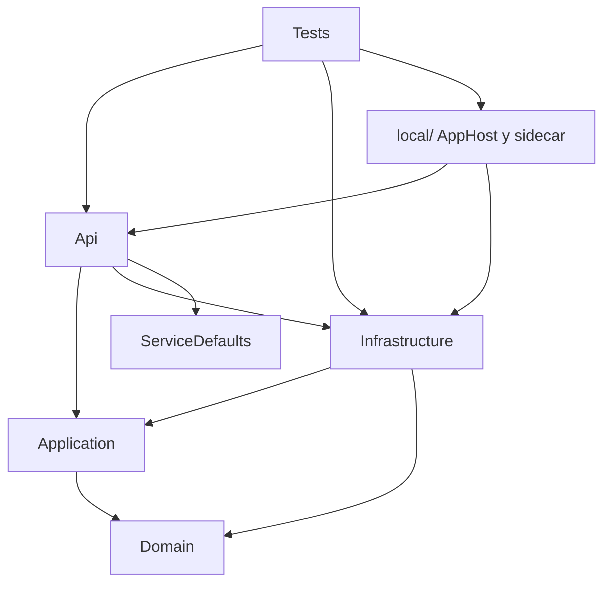
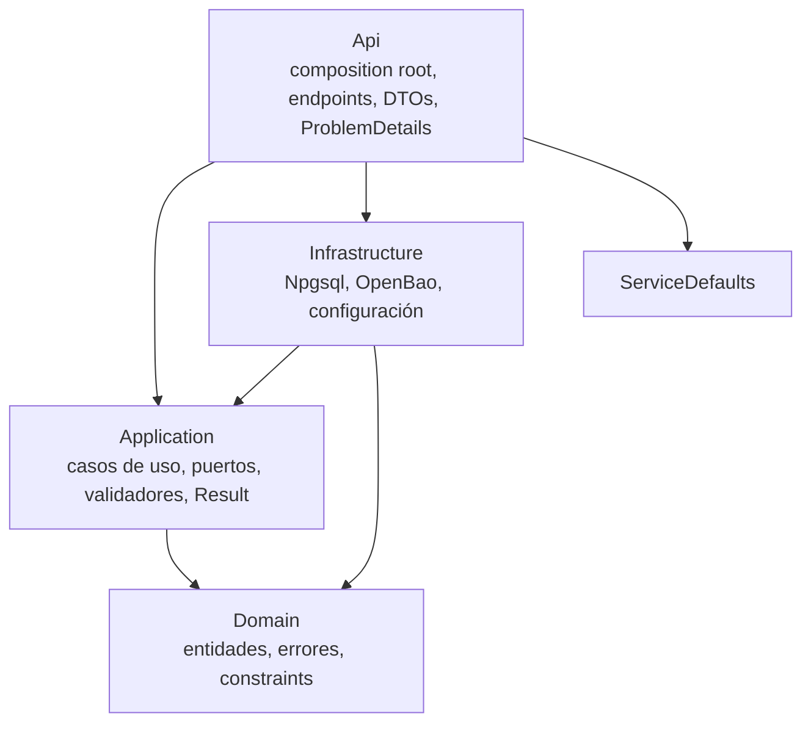

# 03 — Arquitectura y patrones

## Mapa de dependencias actual

> **Estado Batch 4a:** ARCH-001, ARCH-002, ARCH-003, ARCH-004 y ARCH-010 están corregidos
> (ver [`12-batch-4-structure.md`](12-batch-4-structure.md)). El mapa y la tabla siguientes
> describen la foto original de la auditoría; ARCH-008 y el resto de Batch 4b siguen
> pendientes.

La regla de Clean Architecture es que las dependencias apunten hacia dentro:
`Api -> Application -> Domain`, con `Infrastructure` implementando puertos definidos en
`Application`/`Domain`. En la auditoría original el grafo tenía dos violaciones claras:

1. **`Application -> Infrastructure`**: `Application.csproj:16-18` referenciaba Infrastructure.
   `Application` usaba `ITodoRepository`, `TodoFilter` y `TodoTable` de Infrastructure.
2. **`Domain -> ASP.NET Core`**: `Domain.csproj:12-13` referenciaba
   `Microsoft.AspNetCore.Http` y `.Abstractions` (2.3.11), pero ningún tipo de Domain los usaba.

## Hallazgos

| ID | Severidad | Hallazgo | Evidencia | Impacto |
|---|---|---|---|---|
| ARCH-001 | P1 | `Application` referencia `Infrastructure` | `Application.csproj:16-18`; `ITodoRepository`, `TodoTable`, `TodoFilter` | Rompe la regla de dependencias; el dominio/aplicación no se pueden probar sin Infrastructure. |
| ARCH-002 | P2 | `Domain` referencia paquetes legacy de ASP.NET Core sin usarlos | `Domain.csproj:12-13`; sin usos en `src/Domain` | Dependencia EOL innecesaria. |
| ARCH-003 | P2 | `Domain` contiene configuración de host y semántica HTTP | `AppSettings.cs`, `Constants.cs`, `Result.cs:9-10` | Dominio acoplado a ASP.NET/configuración. |
| ARCH-004 | P2 | `Application` usa constantes y filtros de Infrastructure | `FilteredTodoInput.cs:1`; `TodoValidator.cs:3`; `TodoTable.cs` | Acoplamiento de capas y duplicación de constraints. |
| ARCH-005 | P3 | `BaseApiRouter` hereda y deriva `RouteName` del nombre de clase; `UserName`/`Role` sin uso | `BaseApiRouter.cs:7-34` | Diseño frágil y código muerto. |
| ARCH-006 | P2 | `AppConfigurationHelper` re-añade fuentes y `AddUserSecrets` en todos los entornos | `AppConfigurationHelper.cs:43-55` | Precedencia frágil; secretos de desarrollo en producción/tests. |
| ARCH-007 | P3 | `OpenApiConfiguration` monolítico/static y sin tests | `OpenApiConfiguration.cs`; cobertura 1,7% | Drift silencioso del contrato. |
| ARCH-008 | P2 | Sin tests de arquitectura/fitness functions | No existe proyecto de architecture tests | Las violaciones no se detectan automáticamente. |
| ARCH-009 | P3 | `ServiceDefaults` no añade service discovery/resiliencia | `ServiceDefaults/Extensions.cs` | Si el template crece a varios servicios, faltan defaults Aspire. |
| ARCH-010 | P2 | `Result<T>` mezcla dominio con semántica HTTP | `Result.cs:9-10`; `ApiResultExtensions.cs` | Modelo de resultado confuso y difícil de reutilizar. |

## Análisis por patrón

### Composition root

`Api/ConfigureServices.cs` registra explícitamente servicios, validadores y repositorios; no hay
assembly scanning. Es una decisión correcta para Native AOT y para un template: todo es
estático y visible. `EndpointExtension.RegisterMinimalEndpoints` sigue el mismo criterio.

**Mejora:** dividir `ConfigureServices` por concerns (`AddPersistence`, `AddValidation`,
`AddAuth`, `AddObservability`) si crece; ya tiene métodos privados, pero el método público
sigue siendo largo.

### Result pattern

`Result<T>` y `IResultFactory<TResult>` son AOT-friendly y evitan excepciones para flujo de
negocio. El problema es que `Result<T>` vive en Domain y contiene `IsCreated`/`IsNoContent`,
que son conceptos HTTP. Además, la comprobación de colección vacía es genéricamente incorrecta
(BUG-006). Para un template, el resultado debería ser un tipo de Application (o Domain puro) y
el mapeo a HTTP debería vivir en Api.

### Repository

`TodoRepository` es ADO.NET puro, sin reflexión, con parámetros y whitelist de orden. Es
coherente con AOT. Puntos a mejorar:
- `ITodoRepository` y `TodoFilter` deberían vivir en Application (puerto), no en
  Infrastructure.
- `TitleExistsAsync` no recibe owner (BUG-003) y no hay índice único (BUG-004).
- No hay transacciones ni concurrencia optimista; para operaciones de una fila es aceptable,
  pero el chequeo+insert de título necesita una.
- `NpgsqlDataSource` sería más idiomático que `new NpgsqlConnection` por operación, aunque el
  pool estático de Npgsql ya funciona.

### Validación

`BaseAbstractValidator` + `TodoValidator<T>` + `ValidationRunner` es una pipeline clara y
AOT-friendly. Puntos a mejorar:
- `ValidateTitle` no es null-safe (BUG-001).
- `ValidateDateTime` depende de cultura (BUG-009).
- `IsValidEmail` acepta display names (SEC-011).
- `FilteredTodoInputValidator` y `GetTodoTitlesInputValidator` duplican la lista de sort keys.
- Los mensajes tienen typos (“validanting”) y formatos inconsistentes.

### Minimal APIs y routing

`BaseApiRouter` + `IGroupMap` + `CreateAuthorizedRouteGroupBuilder` es un patrón razonable para
agrupar endpoints con políticas. Sin embargo:
- `RouteName` se deriva del nombre de clase (`TodoRoutes` -> `Todo`); un rename rompe la ruta.
- `UserName` y `Role` no se usan en producción; `UserEmail`/`IsAdmin` sí.
- `UserEmail` usa `First()` y puede lanzar 500 (SEC-003).
- `MapAuthorizedGroup` está duplicado con `CreateAuthorizedRouteGroupBuilder` y no se usa.

**Mejora:** introducir `ICurrentUser`/`UserContext` en Application/Api, con `Email`, `IsAdmin`
y `OwnerScope`, y eliminar la herencia de `BaseApiRouter` o reducirla a un helper de mapeo.

### Configuración

`AppConfigurationHelper` hace binding manual (AOT-friendly), pero re-añade fuentes que el host
ya creó y llama a `AddUserSecrets` en todos los entornos. La precedencia documentada
(`appsettings < user secrets < OpenBao < env < command line`) es correcta, pero frágil: dos
fuentes de JSON y una de user secrets duplicadas pueden producir diferencias si cambia el
host. `AppSettingsValidator` se usa manualmente, no está registrado como `IValidateOptions`.

**Mejora:** construir un `ConfigurationBuilder` explícito y testeado, o usar
`builder.Configuration` con `AddJsonFile` una sola vez; registrar el validador con
`AddOptions<AppSettings>().ValidateOnStart()`.

### AOT

La decisión de evitar reflexión, `dynamic`, MediatR y Swashbuckle SwaggerGen es correcta y está
bien documentada en `AGENTS.md`. El publish AOT pasa sin warnings. Puntos a vigilar:
- `dotnet format analyzers` reporta IL2026/IL3050 falsos positivos en `Map*`; no silenciar en
  código.
- `ServiceDefaults` no declara `IsAotCompatible`; el publish del Api lo cubre, pero un futuro
  host que lo use directamente no tiene la misma garantía.
- `ArchUnitNET`/`BannedApiAnalyzers` serían guardarraíles útiles para que no entren reflexión o
  dependencias prohibidas.

## Target design propuesto

Cambios concretos:

1. Mover `ITodoRepository` y `TodoFilter` a `Application/Abstractions` (o `Application/Todo`).
2. Mover las constraints (`TitleMaxLength`, `DescriptionMaxLength`) a `Domain` o
   `Application`; Infrastructure solo traduce a SQL.
3. Eliminar `Microsoft.AspNetCore.Http*` de Domain.
4. Mover `AppSettings`/`Constants` de host a `Api/Configuration` o `Infrastructure`.
5. Sacar `IsCreated`/`IsNoContent` de `Result<T>` o mover `Result<T>` a Application.
6. Introducir `ICurrentUser` y eliminar `BaseApiRouter.UserName`/`Role`.
7. Añadir `tests/CleanWebApiTemplate.ArchitectureTests` con reglas:
   - Domain no depende de Application/Infrastructure/Api/ASP.NET Core.
   - Application no depende de Infrastructure/Api.
   - Infrastructure no depende de Api.
   - Api es el único composition root.
   - `src/` no usa `System.Reflection`, `dynamic` ni `JsonSerializer` por reflexión.
8. Añadir `BannedApiAnalyzers` + `BannedSymbols.txt` para reflexión/`Activator`/`MakeGenericType`.

## ADRs propuestos

| ADR | Decisión |
|---|---|
| ADR-001 | Regla de dependencias: Application define puertos; Infrastructure implementa. |
| ADR-002 | `Result<T>` vive en Application y no conoce HTTP. |
| ADR-003 | Unicidad de título: global o per-owner (decisión pendiente). |
| ADR-004 | Modo de autenticación: LocalSymmetric u OIDC, nunca mezclados. |
| ADR-005 | OpenBao: HTTPS obligatorio fuera de local; token de mínimo privilegio. |
| ADR-006 | Template: GUIDs generados, README incluido, artefactos locales excluidos. |

## Lo que está bien

- Composition root explícito y AOT-friendly.
- Sin MediatR/reflexión; los casos de uso son clases explícitas.
- Separación clara de Api/Application/Domain/Infrastructure a nivel de carpetas.
- `ServiceDefaults` separado y reutilizable.
- Tests de componente/functional con Aspire y contenedores reales.
- Documentación local muy detallada (aunque con drift puntual).
